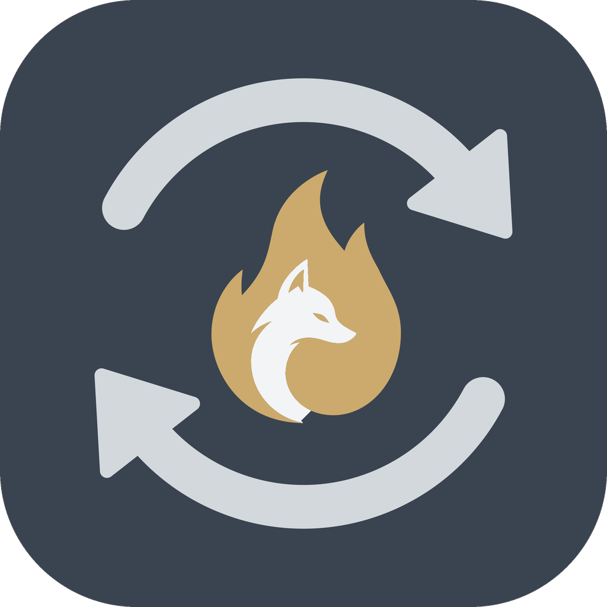

<p align="center">
  
</p>

# Ogneliss Share

Прямая передача файлов между своими устройствами — Android, iPhone и iPad,
Windows, macOS и Linux. **Без учётных записей, без облака, без настроек.**
Код открыт по [лицензии Apache 2.0](LICENSE).

- Сайт: https://ogneliss.ru
- Вопросы и предложения: [Issues](https://github.com/oedante/OgnelissShare/issues)
  или oedante@gmail.com

*English summary below.*

> Это первая рабочая версия (MVP). Сборки для всех платформ — во вкладке
> [Actions](https://github.com/oedante/OgnelissShare/actions) (Artifacts
> последнего запуска), с метки `v*` — в [Releases](https://github.com/oedante/OgnelissShare/releases).

## Как пользоваться

1. На одном устройстве — **«Показать код»**: появится QR-код.
2. На другом — **«Сканировать код»** (на компьютере без камеры — «Вставить
   ссылку», её можно скопировать под QR-кодом).
3. На первом подтвердите подключение, если **4 цифры совпадают** на обоих
   экранах.

Готово: устройства связаны навсегда и видят друг друга, когда включены —
в одной сети Wi-Fi или через интернет. Нажмите на устройство и выберите
«Файлы», «Фото и видео», «Папку» или «Текст или ссылку».

- Файлы от своих устройств принимаются сразу и кладутся в
  **«Загрузки/Ogneliss Share»** (на iPhone — «Файлы → На iPhone → Ogneliss Share»).
- **Разовый обмен** — для файлов с другим человеком: связь только на этот
  раз, каждую передачу получатель подтверждает.
- На Android отправить можно из любого приложения: **«Поделиться» →
  Ogneliss Share**.
- Связь оборвалась — передача продолжится с места обрыва, когда устройство
  снова появится; каждый файл проверяется по хешу.

## Безопасность и приватность

- **Нет учётных записей.** У каждого устройства свой ключ, созданный на нём
  самом; устройства узнают друг друга по ключам.
- **Нет спама и чужих файлов.** Подключиться может только устройство,
  связанное по QR-коду. Посторонние соединения отклоняются сразу после
  рукопожатия — нельзя ни прислать файл, ни узнать, что устройство в сети.
- **Нельзя подменить собеседника.** Подключение идёт по ключу из QR-кода;
  постоянную связь подтверждают 4 цифры на обоих экранах (защита от того,
  кто сфотографировал код издалека). Код одноразовый и живёт 5 минут.
- **Сквозное шифрование.** QUIC и TLS 1.3 со взаимной проверкой ключей
  ([iroh](https://github.com/n0-computer/iroh)). Если прямой путь
  невозможен, данные идут через ретранслятор — он видит только
  зашифрованный поток, ключи устройств и IP-адреса.
- Ключ устройства не попадает в резервные копии Android.

Подробно — [docs/PROTOCOL.md](docs/PROTOCOL.md). Свой ретранслятор на
ogneliss.ru — [docs/RELAY.md](docs/RELAY.md) (пока не указан, сборки
используют общедоступные ретрансляторы n0).

## Как устроено

```
rust/          ядро на Rust: соединения (iroh), сопряжение, передачи, тесты
rust_builder/  плагин Flutter: собирает ядро для каждой платформы (Cargokit)
lib/           интерфейс на Flutter (русский и английский)
tool/          bootstrap.py — каталоги платформ; platform/ — их «накладка»;
               branding/ — значок
docs/          протокол, ретранслятор
```

Интерфейс общается с ядром через три функции C (`osh_call`, `osh_poll`,
`osh_free`) — JSON в обе стороны, без генераторов кода.

## Сборка

Нужны Flutter (stable, 3.38+), Rust (`rustup`, 1.91+) и средства сборки
платформы: Android SDK и NDK, Xcode, Visual Studio с C++ или пакеты GTK
для Linux.

```bash
python3 tool/bootstrap.py   # один раз: каталоги платформ + flutter pub get
flutter run                 # на подключённом устройстве или компьютере
flutter build apk --release --split-per-abi

cd rust && cargo test       # тесты ядра (без Flutter)
```

`bootstrap.py` создаёт `android/`, `ios/`, `macos/`, `windows/`, `linux/`
через `flutter create` и накладывает свои файлы и правки: идентификатор
`com.ogneliss.share`, значки, разрешения, «Поделиться» на Android. Повторный
запуск безопасен.

Подпись Android: файл `android/key.properties` (`storeFile`,
`storePassword`, `keyAlias`, `keyPassword`) — в git не попадает; в CI —
секреты `ANDROID_KEYSTORE_*` (см. [.github/workflows/ci.yml](.github/workflows/ci.yml)).

## Что дальше

- Свой ретранслятор `relay.ogneliss.ru`.
- Приём файлов в фоне на Android (служба переднего плана) и уведомления.
- «Поделиться» на iOS (расширение), перетаскивание файлов на компьютере.
- Общий буфер обмена между своими устройствами.
- Публикация в Google Play, RuStore, App Store.

---

## English

Ogneliss Share sends files directly between your own devices — Android,
iPhone/iPad, Windows, macOS and Linux. **No accounts, no cloud, no
settings.** Open source under the [Apache License 2.0](LICENSE).

**How to use.** Tap “Show code” on one device and “Scan code” on the other
(or paste the link on a computer without a camera), then confirm on the
first device that the 4 digits match. That's it: the devices are linked and
see each other whenever they are on — on the same Wi-Fi or over the
internet. Files from your own devices are accepted automatically into
“Downloads/Ogneliss Share”. “One-time exchange” is for files with another
person: the receiver confirms every transfer. On Android you can send from
any app via Share. Interrupted transfers resume, every file is verified
with BLAKE3.

**Security.** Every device has its own key generated on the device. Only
devices linked with a QR code can connect — all other connections are
rejected right after the handshake, so nobody can spam you or even see
that your device is online. Connections are made to the key from the QR
code, and permanent links are confirmed with matching digits on both
screens. Traffic is end-to-end encrypted (QUIC, TLS 1.3, mutual key
authentication via [iroh](https://github.com/n0-computer/iroh)); a relay,
when needed, only sees encrypted packets. Details:
[docs/PROTOCOL.md](docs/PROTOCOL.md).

**Build.** Flutter (stable, 3.38+), Rust 1.91+ and the platform toolchain:

```bash
python3 tool/bootstrap.py   # once: platform folders + pub get
flutter run
cd rust && cargo test
```

The name “Ogneliss” and the icon are not covered by the license — see
[TRADEMARKS.md](TRADEMARKS.md).
